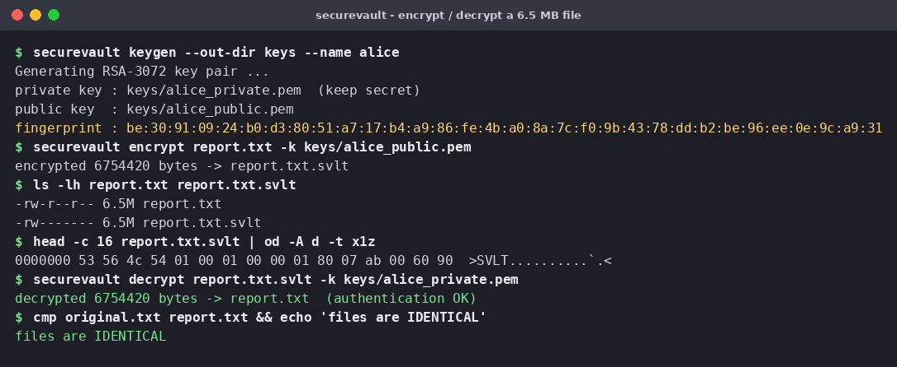
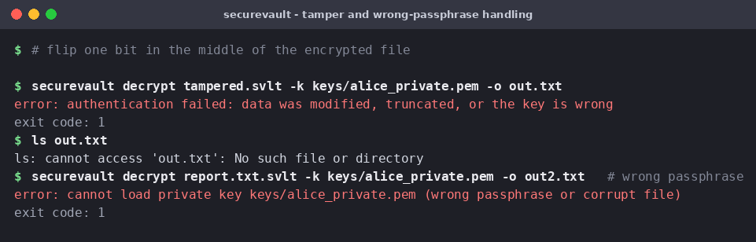
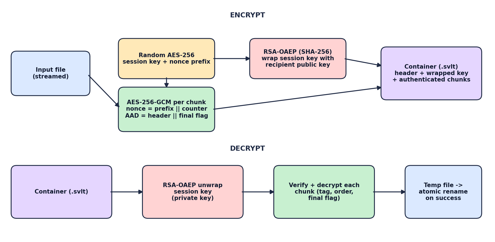
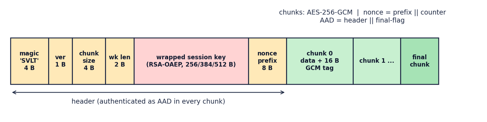

# SecureVault

[](https://github.com/YOUR-USERNAME/securevault/actions/workflows/ci.yml)


**Hybrid file encryption in Python: AES-256-GCM for the data, RSA-OAEP for the key, in a streaming, tamper-evident file format.**

SecureVault encrypts files of any size for a recipient's public key. Only the holder of the matching private key can decrypt them, and any modification, truncation or reordering of the encrypted file is detected before plaintext is released.

> **Status:** educational / portfolio project built on the audited [`cryptography`](https://cryptography.io) library. It has **not** been independently security-reviewed. For production secrets, prefer established tools such as [age](https://age-encryption.org) or GPG. See [SECURITY.md](SECURITY.md).



## Features

- **Hybrid encryption**: a fresh random AES-256 key per file, wrapped with RSA-OAEP (SHA-256).
- **Streaming**: constant memory, files of any size, 64 KiB chunks by default.
- **Tamper-evident**: every chunk is authenticated; the header and a *final-chunk flag* are bound into each tag, so bit flips, **truncation**, **reordering** and header edits all fail.
- **All-or-nothing output**: decryption writes to a temp file and renames only after the *entire* file authenticates. No unauthenticated plaintext is left on disk.
- **Safe key storage**: private keys saved as PKCS#8 encrypted with a passphrase, created with mode `0600`. Existing files are never overwritten without `--force`.
- **CLI and library**: `securevault keygen | encrypt | decrypt | fingerprint`, plus a small typed Python API.
- **Tested**: 27 unit tests covering round-trips at chunk boundaries, every tampering class, wrong keys, wrong passphrases, and CLI behaviour.

## Install

```bash
git clone https://github.com/YOUR-USERNAME/securevault.git
cd securevault
python -m venv .venv && source .venv/bin/activate   # Windows: .venv\Scripts\activate
pip install .            # or: pip install -e ".[dev]" for development
```

## Quick start (CLI)

```bash
# 1. Recipient creates a key pair (prompts for a passphrase to protect the private key)
securevault keygen --out-dir keys --name alice

# 2. Anyone with alice_public.pem can encrypt a file for her
securevault encrypt report.pdf -k keys/alice_public.pem      # -> report.pdf.svlt

# 3. Only Alice can decrypt it
securevault decrypt report.pdf.svlt -k keys/alice_private.pem
```

Verify a public key out-of-band (e.g. read the fingerprint over the phone) before trusting it:

```bash
securevault fingerprint keys/alice_public.pem
```

For scripts and CI, the passphrase can be supplied via the `SECUREVAULT_PASSPHRASE` environment variable. Treat that variable as sensitive; the interactive prompt is safer on shared machines.

### What failure looks like



A corrupted file exits with status `1`, and **no output file is created**.

## Library usage

```python
from securevault import generate_keypair, encrypt_bytes, decrypt_bytes, DecryptionError

private_key, public_key = generate_keypair(3072)

blob = encrypt_bytes(b"attack at dawn", public_key)
assert decrypt_bytes(blob, private_key) == b"attack at dawn"

tampered = bytearray(blob); tampered[-1] ^= 1
try:
    decrypt_bytes(bytes(tampered), private_key)
except DecryptionError as exc:
    print("tampering detected:", exc)
```

For files use `encrypt_file(src, dst, public_key)` / `decrypt_file(src, dst, private_key)`, and `save_keypair` / `load_private_key` for passphrase-protected key storage. A runnable tour is in [`examples/basic_usage.py`](examples/basic_usage.py).

## How it works



1. Generate a random 256-bit **session key** and an 8-byte **nonce prefix**.
2. **Wrap** the session key with the recipient's RSA public key (OAEP, SHA-256).
3. Split the input into chunks. Encrypt chunk *i* with **AES-256-GCM**, nonce = `prefix || i` (32-bit big-endian counter), associated data = `header || final_flag`.
4. On decryption, unwrap the key, then verify and decrypt chunks in order. A missing, altered, duplicated or reordered chunk, or a missing final chunk, causes authentication to fail.



The byte-level specification is in [docs/FORMAT.md](docs/FORMAT.md).

### Design decisions

| Decision | Rationale |
|---|---|
| Fresh session key per file | Nonce reuse under one AES-GCM key is catastrophic; a unique key per file removes the risk across files. |
| Nonce = random prefix + counter | Deterministic, collision-free within a file (up to 2^32 chunks) with no per-chunk randomness needed. |
| Header and final flag in the AAD | Prevents truncation at chunk boundaries, chunk reordering, and downgrade or header tampering. |
| RSA-OAEP, not PKCS#1 v1.5 | Randomised padding with provable security against chosen-ciphertext attacks. |
| Default RSA-3072 (min 2048) | About 128-bit security; 2048 is the floor, enforced in code. |
| Temp file plus atomic rename | Streaming decryption releases chunks before the end is verified, so output is committed only on success. |

## Development

```bash
pip install -e ".[dev]"
python -m pytest              # or: python -m unittest discover -s tests -v
ruff check . && mypy
python examples/benchmark.py
```

Project layout:

```
src/securevault/   core.py (format + streaming), keys.py, cli.py, exceptions.py
tests/             round-trip, tamper, key-handling and CLI tests
docs/              FORMAT.md, images
examples/          basic_usage.py, benchmark.py
.github/workflows/ ci.yml (lint, type-check, tests on Python 3.9-3.13)
```

### Performance

Streaming file-to-file throughput on the development sandbox (RSA-3072, single run, noisy; your hardware will differ). Run `examples/benchmark.py` for your own numbers:

| Size | Encrypt | Decrypt |
|---|---|---|
| 10 MB | ~940 MB/s | ~250 MB/s |
| 200 MB | ~720 MB/s | ~155 MB/s |

Decryption is slower than encryption here mainly because it verifies each chunk and writes through a temp file.

## Limitations and roadmap

SecureVault provides confidentiality and integrity for data at rest, but **not sender authentication**: anyone with your public key can create a file "for you". See [SECURITY.md](SECURITY.md) for the full threat model.

- [ ] Sender signatures (RSA-PSS / Ed25519) for authenticity
- [ ] Multiple recipients per file
- [ ] Password-based mode (scrypt / Argon2id) for symmetric-only use
- [ ] Post-quantum key encapsulation (ML-KEM) as an alternative to RSA
- [ ] `securevault inspect` to print header info without a key

## Contributing

Issues and pull requests are welcome. See [CONTRIBUTING.md](CONTRIBUTING.md).

## License

[MIT](LICENSE)
